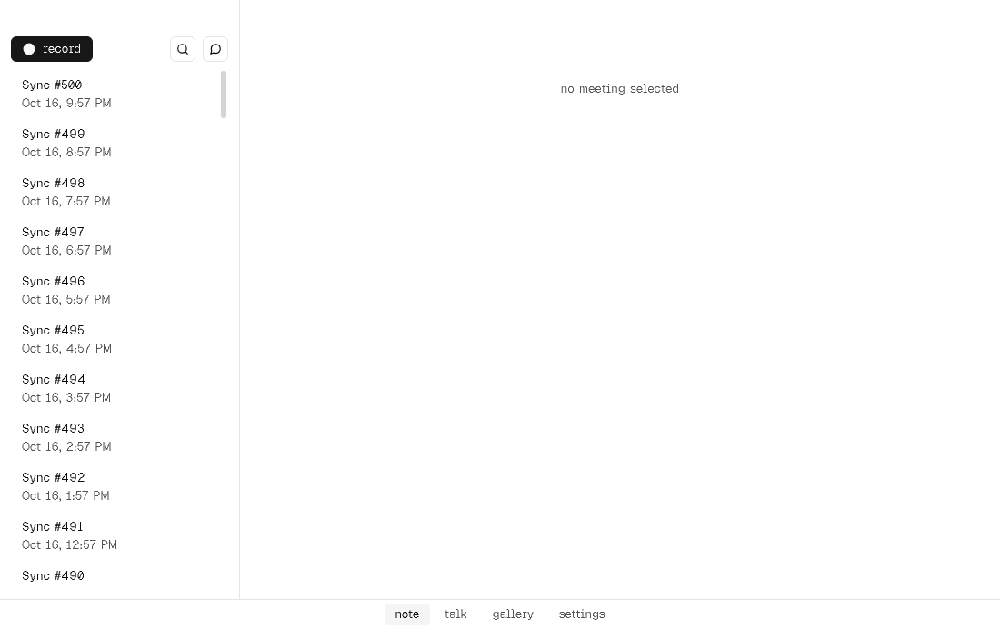
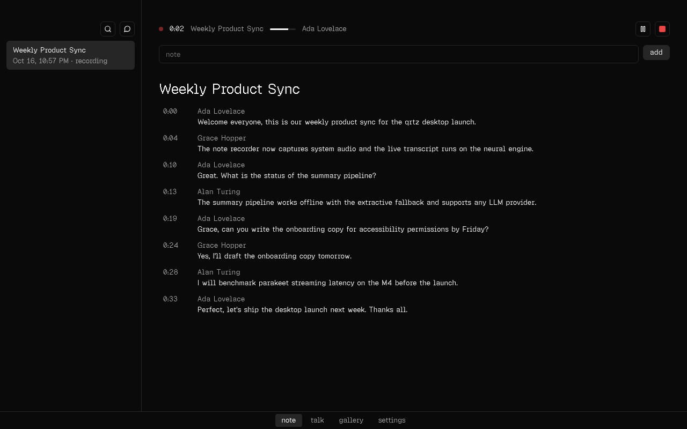

# qrtz

**Meeting notes that write themselves, on-device.** qrtz is a macOS app. It notices when you join a Zoom or Google Meet call, records it (with your OK, or always if you choose), transcribes live on your Mac, and gives you a summary, action items and a searchable archive you can chat with. Audio and transcripts stay local unless you add a cloud LLM key, and one switch turns cloud features off entirely.

| Home (light)                                       | Meeting summary                                                                                     |
| -------------------------------------------------- | --------------------------------------------------------------------------------------------------- |
|            |                                    |
| **Live recording**                                 | **Mini HUD with notes · Backup progress**                                                           |
|  |   |

These screenshots come from the (now removed) Electron e2e suite on Linux with the mock helper; the Tauri app renders the same UI. Dark is the default theme; Light and System are in Settings → App → Theme. More are in [`docs/screenshots/`](docs/screenshots/), including light variants of the summary and mini HUD.

## Quickstart on a Mac

Needs Apple Silicon, macOS 14.2 or later, Xcode 16 or later, Rust 1.90 (`rust-toolchain.toml`) and Node 22.13 or later.

```sh
git clone https://github.com/qrtz-ai/qrtz && cd qrtz
npm ci
npm run build:helper         # Swift helper (AX, audio capture), release arm64
npm start                    # tauri dev: the Rust core + the React renderer with hot reload
```

- **AI summaries:** add an OpenRouter key in onboarding or settings (stored in the Keychain), or set `QRTZ_SECRET_OPENROUTER`. Without a key, qrtz uses its on-device summarizer.
- **Packaged app:** `npm run make` runs `tauri build` (`.app` + `.dmg`). Signing and notarization: [docs/release.md](docs/release.md).
- **No Mac?** Everything except real capture runs on Linux with the Rust mock helper: `QRTZ_MOCK_HELPER=1 QRTZ_MOCK_SCENARIO=standup QRTZ_MOCK_SPEED=0.1 npm start`.

## What it does

- **Calendar-free auto-start:** detects Zoom (app and web) and Meet (Chrome and Safari) through the Accessibility tree. It reads the title, participants and active speaker, then asks whether to record or starts on its own if you chose "Always record".
- **Live transcript:** on-device streaming ASR with speaker names, a floating mini HUD (pause, notes, stop), a ⌘⇧R toggle and a menu bar item.
- **Live notes (Granola-style):** timestamped notes from the HUD or the Notes tab. They shape the summary, and TODOs become action items.
- **After the call:** summary, action items and Q&A in five templates (General, 1:1, Standup, Sales, Interview). It uses OpenRouter, or Ollama or the extractive fallback when local-only is on.
- **Your archive:** full-text and semantic search (on-device MiniLM), chat with one meeting or all of them (citations jump to the moment), speaker rename and merge, Markdown export, and delete with confirmation and Undo.
- **Privacy:** pause capture (⌘⇧P), excluded apps, a "never send to the cloud" switch, and optional audio retention.
- **Backup:** one streamed zip with a sha256 manifest and a progress bar. Import verifies everything and never overwrites.
- **Built to fail soft:** if the helper crashes, the audio and transcript are kept. LLM failures fall back to the on-device summary with a Retry button. Settings sections load independently.

## Architecture

```
┌──────────── Tauri 2 shell (apps/desktop/src-tauri) ────────────┐   JSON lines + fds   ┌──── qrtz-helper (Swift) ────┐
│ qrtz-app: capability-checked IPC router (contracts/*.json)      │ ◀──────────────────▶ │ AX · ScreenCaptureKit /      │
│ qrtz-lifecycle · qrtz-storage (SQLite+FTS5) · qrtz-llm ·        │                      │ Core Audio taps · echo gate  │
│ qrtz-search (MiniLM via candle) · qrtz-talk · qrtz-backup       │                      └──────────────┬───────────────┘
└──────┬──────────────────────────────────────┬──────────────────┘                     PCM over FIFOs │
       │ invoke / events                      │ spawn, confined (Landlock+seccomp / sandbox)        ▼
┌──────▼───────────────┐              ┌───────▼──────────────────────────────────────────────────────────┐
│ Renderer (React 19)  │              │ qrtz speech module (signed, updatable, model-agnostic; ADR 0046) │
│ shell + sub-apps     │              └──────────────────────────────────────────────────────────────────┘
│ @qrtz/ui only        │
└──────────────────────┘
```

- **Monorepo:** Cargo workspace (`crates/*`, `apps/desktop/src-tauri`) and npm workspaces. `packages/core` holds the zod IPC contract (rendered to `contracts/*.json` by `npm run gen:contracts`, embedded by the Rust router). `packages/ui` is the design system (Geist Pixel, Feather icons, tokens, light and dark) and owns every visual component. Each sub-app (`packages/features/{note,talk,settings,gallery}`) declares its capabilities and only composes `@qrtz/ui`. `apps/desktop` is the Tauri app and its renderer. `npm run lint` enforces the package boundaries, the type scale, lowercase UI text and no styling outside ui.
- **Shared spec:** `spec/` holds the JSON vectors, scenarios and fixtures; the Rust tests are the oracle (ADR 0061).
- **Security:** strict CSP, capability-checked channels, a trusted-sender check on every command, secrets in the Keychain, dev knobs ignored in release builds (N87). See [docs/security.md](docs/security.md).
- **Docs:** [architecture](docs/architecture.md) · [rust core api](docs/rust-core-api.md) · [migration status](docs/tauri-migration-status.md) · [design system](docs/design-system.md) · [release](docs/release.md) · [ADRs](docs/adr/)

## Status (2026-10-17)

**Verified on Linux with the Rust mock helper:** `cargo test --workspace` (the Rust core, the shell, the app E2E through the real router and helper bridge), the Swift helper core (`swift test`, Foundation-only parts), vitest for the renderer packages, and the renderer Playwright suite against the mocked backend (`npm run e2e`). Parity E2E against the real Tauri app is in progress (docs/e2e-parity.md).

**Needs a Mac:** see the Mac-only list in [docs/tauri-migration-status.md](docs/tauri-migration-status.md) and [docs/mac-verify.md](docs/mac-verify.md).

## Accounts needed

| Account                                                                        | Used for                                                        | Status                                  |
| ------------------------------------------------------------------------------ | --------------------------------------------------------------- | --------------------------------------- |
| Apple Developer ID (plus an app-specific password or API key for notarization) | Signing, notarization, auto-update                              | Needed before the first release         |
| OpenRouter API key                                                             | Cloud summaries and chat (`QRTZ_SECRET_OPENROUTER` or Settings) | Optional; on-device fallback without it |
| Hugging Face token                                                             | Only if model downloads get rate-limited                        | Optional                                |
| Update-feed host (R2, S3 or GitHub Releases)                                   | `QRTZ_UPDATE_FEED_URL` at build time                            | Later; off by default                   |

## Commands

```sh
npm start              # tauri dev
npm run make           # tauri build (.app + .dmg on macOS)
npm run check          # lint + typecheck + vitest
npm run check:rust     # cargo fmt --check + clippy -D warnings + cargo test --workspace
npm run gen:contracts  # re-render contracts/*.json from the zod contract
npm run e2e            # renderer Playwright suite (mocked backend)
npm run test:helper    # Swift XCTests
```

## How to add a sub app

1. Copy an example: `cp -r packages/features/settings packages/features/notes`.
2. In `packages/features/notes/package.json`, set `"name": "@qrtz/feature-notes"`.
3. In `src/index.ts`, set a unique manifest:
   ```ts
   export default defineSubApp({
     manifest: { id: 'notes', name: 'Notes', icon: '✎', order: 10 },
     load: () => import('./NotesView'),
   });
   ```
   Rename the view component to match.
4. Wire it into the shell:
   - Add `"@qrtz/feature-notes": "*"` to `apps/desktop/package.json` dependencies.
   - Add `{ "path": "../../packages/features/notes" }` to `apps/desktop/tsconfig.json` references.
   - Add the same path to the root `tsconfig.json`.
   - Add `notes` to the list in `apps/desktop/src/shell/subapps.ts`.
5. Run `npm install && npm run check`. The new sub app appears in the bottom tabs.

If a sub app needs the backend, add a channel to `ipcContract` in
`packages/core/src/ipc/contract.ts`, run `npm run gen:contracts`, and answer it in `crates/qrtz-app`
(the port that owns it, see `crates/qrtz-app/src/ports.rs`).

## qrtz note (meeting recorder)

- **Detection and metadata:** finds Zoom (app and web) and Google Meet (Chrome and Safari) through the macOS Accessibility tree, and reads the title, participants and active speaker.
- **Live transcription:** on-device streaming through the qrtz speech module, with speakers per channel.
- **After the meeting:** an LLM writes the summary, action items and Q&A.
- **LLM keys:** OpenRouter is the default. Set `QRTZ_SECRET_OPENROUTER` or add a key in Settings. Without a key, an on-device extractive summarizer is used.
- **Storage and export:** local SQLite with full-text search, and Markdown export.

On Linux (and in tests) the Rust mock helper replaces the Swift helper. To watch a scripted meeting:

```sh
QRTZ_MOCK_HELPER=1 QRTZ_MOCK_SCENARIO=standup QRTZ_MOCK_SPEED=0.1 npm start
```

The full flow is covered by `crates/qrtz-app/tests/` (boot, n83, note_speech, talk).
