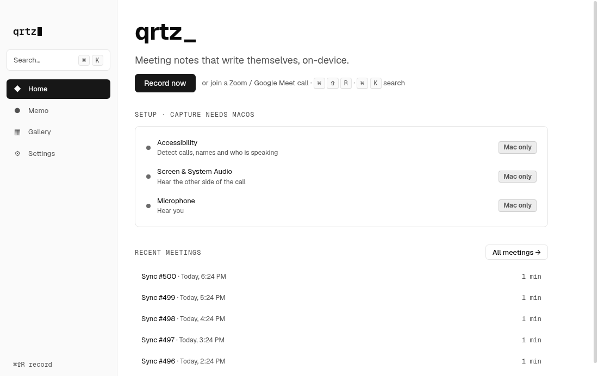
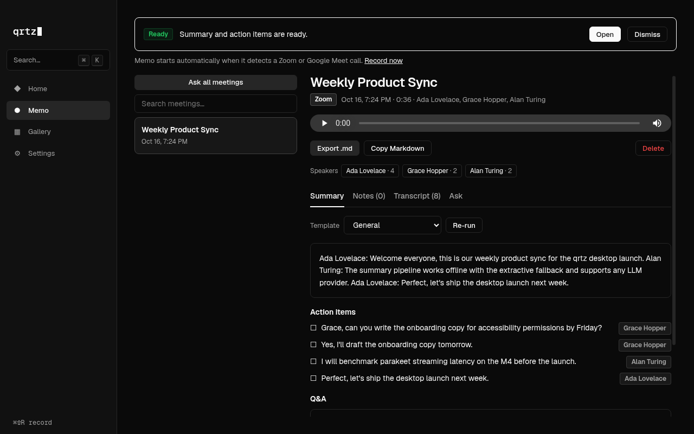
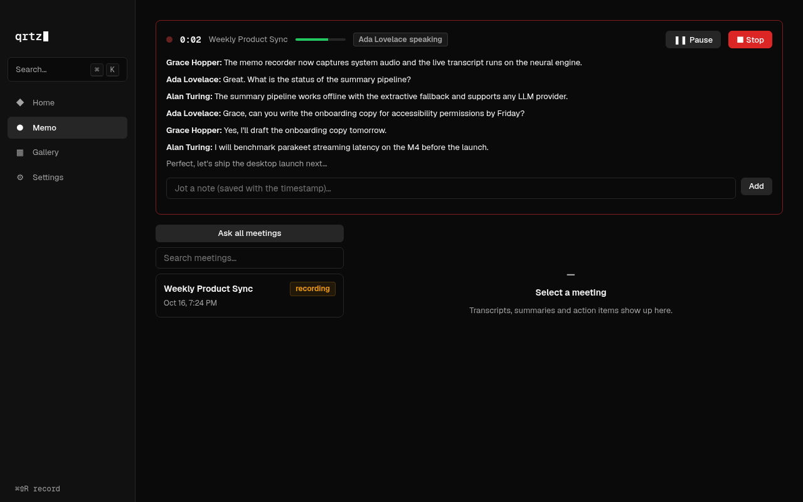
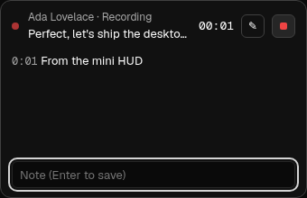
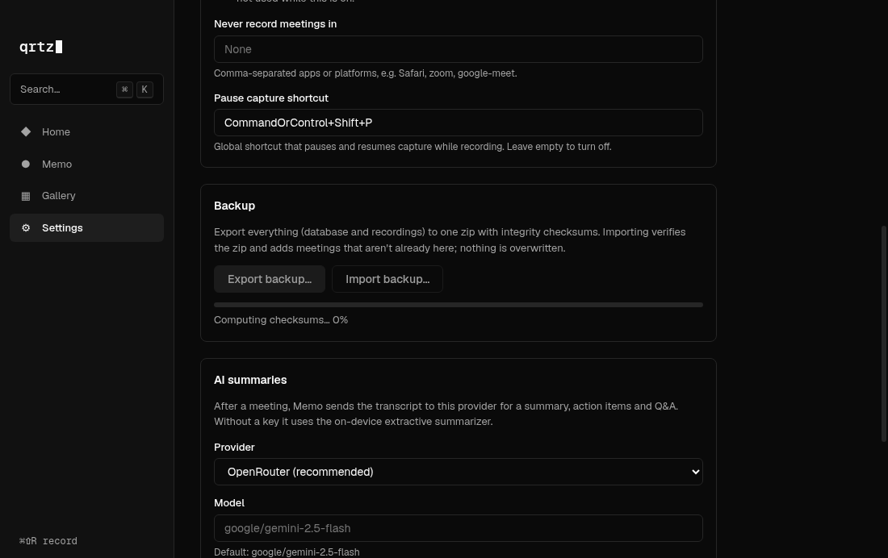

# qrtz

**Meeting notes that write themselves, on-device.** qrtz is a macOS app. It notices when you join a Zoom or Google Meet call, records it (with your OK, or always if you choose), transcribes live on your Mac, and gives you a summary, action items and a searchable archive you can chat with. Audio and transcripts stay local unless you add a cloud LLM key, and one switch turns cloud features off entirely.

| Home (light)                                       | Meeting summary                                                                                     |
| -------------------------------------------------- | --------------------------------------------------------------------------------------------------- |
|            |                                    |
| **Live recording**                                 | **Mini HUD with notes · Backup progress**                                                           |
|  |   |

These screenshots come from the e2e suite on Linux with the mock helper. Regenerate them with `npm run screenshots`, which packages the app, runs the screenshot specs and refreshes `docs/screenshots/`. Dark is the default theme; Light and System are in Settings → Appearance. More are in [`docs/screenshots/`](docs/screenshots/), including light variants of the summary and mini HUD.

## Quickstart on a Mac

Needs Apple Silicon, macOS 14.2 or later, Xcode 16 or later, and Node 22.13 or later.

```sh
git clone https://github.com/qrtz-ai/qrtz && cd qrtz
npm ci                       # also installs the Electron binary
npm run build:helper         # Swift helper (AX, audio, ASR), release arm64
npm start                    # run the app with hot reload
```

- **AI summaries:** add an OpenRouter key in Settings → AI summaries (stored with safeStorage), or set `QRTZ_SECRET_OPENROUTER`. Without a key, qrtz uses its on-device summarizer.
- **Packaged app:** `npm run package` builds `apps/desktop/out/`; `npm run make` builds a `.dmg` and `.zip`. To sign and notarize, run `scripts/release-mac.sh` (see [docs/release.md](docs/release.md)).
- **No Mac?** Everything except real capture runs on Linux with a scripted mock meeting: `QRTZ_MOCK_HELPER=1 QRTZ_MOCK_SCENARIO=standup QRTZ_MOCK_SPEED=0.1 npm start`.

## What it does

- **Calendar-free auto-start:** detects Zoom (app and web) and Meet (Chrome and Safari) through the Accessibility tree. It reads the title, participants and active speaker, then asks whether to record or starts on its own if you chose "Always record".
- **Live transcript:** on-device streaming ASR with speaker names, a floating mini HUD (pause, notes, stop), a ⌘⇧R toggle and a menu bar item.
- **Live notes (Granola-style):** timestamped notes from the HUD or the Notes tab. They shape the summary, and TODOs become action items.
- **After the call:** summary, action items and Q&A in five templates (General, 1:1, Standup, Sales, Interview). It uses OpenRouter, or Ollama or the extractive fallback when local-only is on.
- **Your archive:** full-text and semantic search (on-device MiniLM), chat with one meeting or all of them (citations jump to the moment), speaker rename and merge, Markdown export, and delete with confirmation and Undo.
- **Privacy:** pause capture (⌘⇧P), excluded apps, a "never send to the cloud" switch, and optional audio retention.
- **Backup:** one streamed zip with a sha256 manifest and a progress bar. Import verifies everything and never overwrites.
- **Built to fail soft:** if the helper crashes, the audio and transcript are kept. LLM failures fall back to the on-device summary with a Retry button. Settings sections load independently.

## Architecture

```
┌──────────────── Electron main ─────────────────┐     JSON lines over stdio     ┌──────── qrtz-helper (Swift) ────────┐
│ capability-checked IPC router (zod contract)    │ ◀───────────────────────────▶ │ AX scraping · ScreenCaptureKit /     │
│ windows · tray · shortcuts · backup · updates   │                               │ Core Audio taps · echo cancel · ASR  │
└──────┬───────────────────────────┬─────────────┘                               └──────────────────────────────────────┘
       │ typed invoke/events       │ MessagePort
┌──────▼───────────────┐   ┌───────▼───────────────────────────────┐
│ Renderer (React 19)  │   │ utilityProcess worker                  │
│ shell + lazy sub-apps│   │ node:sqlite + FTS5 · migrations ·      │
│ @qrtz/ui design sys. │   │ summaries/chat · transformers.js embed │
└──────────────────────┘   └───────────────────────────────────────┘
```

- **Monorepo:** npm workspaces. `packages/core` holds the contracts, IPC schema, DB and pipeline. `packages/ui` is the design system (tokens, light and dark themes, components). Each sub-app (`packages/features/{home,memo,gallery,settings}`) declares the capabilities it needs. `apps/desktop` composes them. `npm run lint` enforces the package boundaries.
- **Security:** context isolation, sandbox, strict CSP, Electron fuses, and capability-checked channels. Secrets live only in safeStorage or env vars, and dev-only env vars are stripped from packaged builds. See [docs/security.md](docs/security.md).
- **Docs:** [PLAN.md](PLAN.md) · [LOOP.md](LOOP.md) · [PROGRESS.md](PROGRESS.md) · [architecture](docs/architecture.md) · [design system](docs/design-system.md) · [tokens](docs/design-tokens.md) · [test matrix](docs/test-matrix.md) · [release](docs/release.md)

## Status (2026-10-16)

**Verified on Linux with the mock helper:** every user-facing flow in [docs/test-matrix.md](docs/test-matrix.md) has a test. Every push runs lint, typecheck, about 120 unit tests, the packaged smoke test, 23 Electron e2e tests (axe-clean in dark and light, cold start about 0.65 s) and 29 Swift tests. A fresh-clone check (`scripts/fresh-clone-check.sh`) proves it builds from scratch. Large libraries are covered too: 500 meetings, a 2-hour transcript, and a 400 MB backup with bounded memory.

**Needs a Mac to verify** (about 10 minutes; see the checklist in [docs/mac-verify.md](docs/mac-verify.md)):

- Building the Swift helper with Xcode (`npm run build:helper`, `QRTZ_REQUIRE_SWIFT=1 npm run test:helper`).
- Real capture: ScreenCaptureKit / Core Audio system audio, the microphone, and the TCC prompts.
- AX scraping against live Zoom and Meet (synthetic fixtures cover 11 layouts today) and FluidAudio ASR plus echo cancellation on real calls.
- The Keychain-backed API key path, and a signed and notarized run of `scripts/release-mac.sh`.

## Accounts needed

| Account                                                                        | Used for                                                        | Status                                  |
| ------------------------------------------------------------------------------ | --------------------------------------------------------------- | --------------------------------------- |
| Apple Developer ID (plus an app-specific password or API key for notarization) | Signing, notarization, auto-update                              | Needed before the first release         |
| OpenRouter API key                                                             | Cloud summaries and chat (`QRTZ_SECRET_OPENROUTER` or Settings) | Optional; on-device fallback without it |
| Hugging Face token                                                             | Only if model downloads get rate-limited                        | Optional                                |
| Update-feed host (R2, S3 or GitHub Releases)                                   | `QRTZ_UPDATE_FEED_URL` at build time                            | Later; off by default                   |

## Commands

```sh
npm start              # dev app (Vite HMR)
npm run check          # lint + typecheck + unit tests
npm run package        # packaged app → apps/desktop/out/
npm run make           # .dmg + .zip (macOS)
npm run e2e            # Electron e2e (run package first; xvfb-run -a on Linux)
npm run smoke:packaged # packaged-binary checks (embeddings backends, env stripping)
npm run test:helper    # Swift XCTests (QRTZ_REQUIRE_SWIFT=1 makes a missing toolchain fatal)
scripts/fresh-clone-check.sh   # clone → npm ci → lint → test → package → e2e
```

## How to add a sub app

1. Copy an example: `cp -r packages/features/home packages/features/notes`.
2. In `packages/features/notes/package.json`, set `"name": "@qrtz/feature-notes"`.
3. In `src/index.ts`, set a unique manifest:
   ```ts
   export default defineSubApp({
     manifest: { id: 'notes', name: 'Notes', icon: '✎', order: 10 },
     load: () => import('./NotesView'),
   });
   ```
   Rename the view component to match.
4. Wire it into the shell:
   - Add `"@qrtz/feature-notes": "*"` to `apps/desktop/package.json` dependencies.
   - Add `{ "path": "../../packages/features/notes" }` to `apps/desktop/tsconfig.json` references.
   - Add the same path to the root `tsconfig.json`.
   - Add `notes` to the list in `apps/desktop/src/shell/subapps.ts`.
5. Run `npm install && npm run check`. The new sub app appears in the sidebar.

If a sub app needs the main process, add a channel to `IpcContract` in
`packages/core/src/ipc.ts`, add it to `IPC_CHANNELS`, and handle it in
`apps/desktop/src/ipc.ts`.

## Memo (meeting recorder)

- **Detection and metadata:** finds Zoom (app and web) and Google Meet (Chrome and Safari) through the macOS Accessibility tree, and reads the title, participants and active speaker.
- **Live transcription:** on-device NVIDIA Parakeet streaming. The live transcript is final.
- **After the meeting:** an LLM writes the summary, action items and Q&A.
- **LLM keys:** OpenRouter is the default. Set `QRTZ_SECRET_OPENROUTER` or add a key in Settings. Without a key, an on-device extractive summarizer is used.
- **Storage and export:** local SQLite with full-text search, and Markdown export.

On Linux (and in tests) a TypeScript mock replaces the Swift helper. To watch a scripted meeting:

```sh
QRTZ_MOCK_HELPER=1 QRTZ_MOCK_SCENARIO=standup QRTZ_MOCK_SPEED=0.1 npm start
```

The full flow is covered by `e2e/memo.spec.ts` (`npm run package && xvfb-run -a npm run e2e`).
