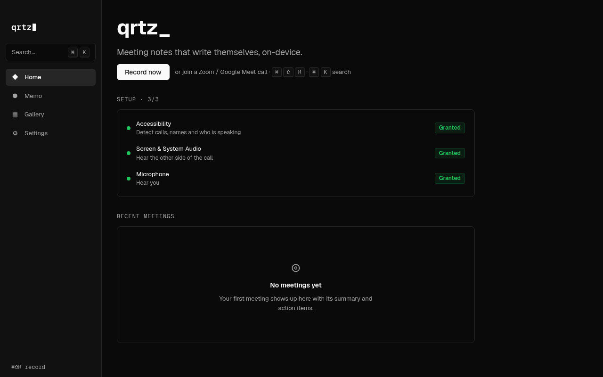
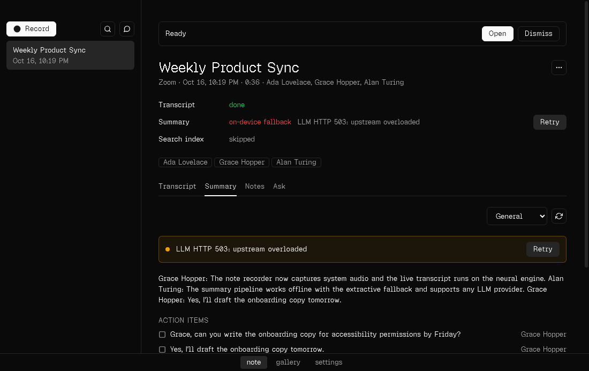

# qrtz

qrtz desktop app for macOS: an Electron shell hosting modular React "sub apps", all built on a shared design system.

## Status (2026-10-16)

**Works today (verified on Linux with the mock helper, lint/typecheck/unit/package/e2e green):**

- Home dashboard: recent meetings, permission status, quick record.
- Memo: auto-start on Zoom/Meet detection (mocked off-Mac), live streaming transcript (final, no re-transcription), summary (OpenRouter, or the extractive fallback without a key), FTS search, Markdown export, chat, retention, ⌘⇧R shortcut, mini HUD.
- Fail-soft: if the helper is missing or crashes mid-meeting, the audio and transcript up to the crash are kept and the meeting is finalized (`e2e/crash.spec.ts`). Startup recovery finishes meetings a crash left behind.
- Large meetings: a 2-hour, 1500-segment meeting opens in ~0.2 s, and search takes ~0.5 s (`e2e/large-a11y.spec.ts`).
- Error states: the capture helper missing or stopped (shown on Home and Memo, recording disabled), LLM failures (falls back to the on-device summary with a Retry button), Settings sections that load independently, and a meeting that fails to load (Try again).
- Chat: per-meeting Q&A (the Ask tab) and "Ask all meetings" (full-text retrieval across transcripts). Answers come from OpenRouter with citations when a key is set, or as extractive quotes without one. Clicking a citation jumps to that moment in the transcript.
- Menu bar (tray) item: the recording state, with elapsed time in the menu bar, plus Start/Stop, Record this meeting / Not now, Open qrtz and Quit. Shown on macOS and Windows; opt in on Linux with `QRTZ_TRAY=1`.
- Semantic chat retrieval: an on-device MiniLM model (transformers.js, ~23 MB, downloaded once) runs in the worker. It's combined with full-text search by rank fusion. If the model can't load, retrieval falls back to full-text only. Packaged builds bundle transformers.js with native onnxruntime-node, trimmed to the target platform. Where no native binary exists (Intel Macs), they use an onnxruntime-web WASM fallback that produces identical vectors. `npm run smoke:packaged` checks both backends against the packaged binary.
- Live notes (Granola-style): jot notes in the live HUD or in a meeting's Notes tab. Each is saved with its recording timestamp. The AI summary is built around your notes plus the transcript; the on-device fallback leads with "Your notes: …" and turns TODO notes into action items. Notes are included in the Markdown export.
- Summary templates: General, 1:1, Standup, Sales call and Interview. Set a default in Settings, change it per meeting from the Summary tab (which re-runs the summary), and the choice is stored with the meeting. Re-run is available any time.
- Backup and restore: Settings → Backup exports one zip with a consistent DB snapshot, all recordings and a sha256 manifest. Import verifies every hash, SQLite integrity and the schema version, then merges meetings that aren't already present (it never overwrites). Tampered or foreign zips are rejected.
- Privacy:
  - Pause capture: a HUD button or a global shortcut (default ⌘⇧P, configurable). While paused, the helper writes silence so the audio stays aligned and transcribes nothing.
  - Excluded apps or platforms are never detected or prompted.
  - "Never send audio or transcripts to the cloud" forces local-only: on-device summaries and chat (Ollama allowed); cloud keys aren't read.
- Calendar-free auto-start: a detected Zoom or Meet call shows a "Record?" prompt in the app, plus an OS notification when qrtz isn't focused. "Always record" (also in Settings) starts recording with no prompt.
- Speaker rename and merge in meeting detail.
- Hundreds of meetings: the Memo list pages 100 at a time ("Show 100 more"), and so do search results. Crash recovery finds stuck meetings at any age.
- OpenRouter path: proven end to end against a local OpenAI-compatible stub server (`apps/desktop/src/worker/llm-openrouter.test.ts` and `e2e/states.spec.ts`), without a key.
- Accessibility: no serious or critical axe violations (WCAG 2.1 AA) on Home, Memo, Gallery, Settings or the palette. Transcript rows can be operated by keyboard.
- Swift helper core (protocol, DSP, echo pipeline with the LocalVQE → gate fallback): 29 tests pass on Linux.
- Meeting scrapers (participants, active speaker, self name, captions) are tested against 11 synthetic AX-tree fixtures (`native/qrtz-helper/Tests/QrtzHelperCoreTests/Fixtures/ax`):
  - Zoom app: gallery and speaker views, with and without captions.
  - Zoom web.
  - Meet in Chrome and Safari: grid, presenting, captions on and off, German and French.
  - Real `--dump-ax` captures from a Mac should replace or extend them.

- Auto-update: an optional self-hosted static feed (R2/S3 or GitHub Releases) baked in at build with `QRTZ_UPDATE_FEED_URL`. It's off by default.
- Release: `scripts/release-mac.sh` signs (hardened runtime and entitlements), notarizes and staples once a Developer ID exists. The checklist is in [docs/release.md](docs/release.md).

**Needs a Mac to verify (see docs/mac-verify.md):**

- Real capture: ScreenCaptureKit / Core Audio system audio, the microphone, and the TCC permission prompts.
- FluidAudio streaming ASR and LocalVQE echo cancellation on real Zoom (app and web) and Meet (Chrome and Safari) calls.
- Building the helper with Xcode, plus a signed and notarized run of `scripts/release-mac.sh`.

**Accounts / secrets needed:**

- OpenRouter API key: `QRTZ_SECRET_OPENROUTER` or Settings (stored with safeStorage).
- Apple Developer ID (signing, notarization, auto-update).
- Optional: a Hugging Face token if model downloads are rate-limited.

## Screenshots

These were captured by `e2e/screens.spec.ts` and `e2e/states.spec.ts` on Linux with the mock helper. Refresh them with `QRTZ_DOC_SHOTS=1 xvfb-run -a npx playwright test -c e2e/playwright.config.ts screens`.

| First run                                                         | Live recording                                                          |
| ----------------------------------------------------------------- | ----------------------------------------------------------------------- |
|          |                   |
| **Meeting summary**                                               | **LLM failure with retry**                                              |
|  |  |

More screenshots in `docs/screenshots/`: home-with-meetings, meeting-transcript, memo-detected, settings, palette, helper-missing.

## Requirements

- Node.js >= 22.13 and npm >= 10.9 (required by Electron Forge 8)

## Commands (run from the repo root)

```sh
npm install
npm start          # run the desktop app (Vite HMR for the renderer)
npm run lint       # oxlint + oxfmt check + workspace boundary check
npm run lint:fix   # auto-fix lint/format
npm run typecheck  # tsc -b across all workspace projects
npm test           # vitest unit tests
npm run e2e        # Playwright Electron smoke test (run `npm run package` first; xvfb-run on Linux)
npm run check      # lint + typecheck + test
npm run package    # packaged app in apps/desktop/out/
npm run make       # distributables in apps/desktop/out/make/ (.dmg + .zip on macOS)
```

> DMGs can only be built on macOS. On Linux, `npm run package` works but the DMG
> maker is skipped. Code signing and notarization aren't set up yet.

## Architecture

Full plan: [PLAN.md](PLAN.md) · loop rules: [LOOP.md](LOOP.md) · log: [PROGRESS.md](PROGRESS.md) · [security](docs/security.md) · [research](docs/research-memo.md)

**Process model:** main does orchestration and the validated IPC router. A supervised `utilityProcess` worker runs SQLite, migrations and heavy jobs. A supervised native Swift helper does AX scraping, audio capture and ASR, talking JSON-lines over stdio, with a TS mock on Linux and in tests.

```
apps/
  desktop/                 Electron shell: main, preload, React renderer host
packages/
  core/      @qrtz/core    sub-app contract + registry, shared types, typed IPC contract
  ui/        @qrtz/ui      React design system: tokens, theme, Text, Button
  features/
    home/     @qrtz/feature-home      example sub app
    settings/ @qrtz/feature-settings  example sub app (uses the IPC bridge)
scripts/check-boundaries.mjs          enforces dependency rules
docs/architecture.md                  research notes and rationale
```

- **npm workspaces**, no build step for internal packages: each package exports its
  TypeScript source and Vite compiles it into the shell bundle.
- **TypeScript project references** (`tsconfig.base.json` plus `tsc -b`) give per-package
  typechecking in dependency order.
- **Dependency rules** (checked by `npm run lint`):
  - `core` and `ui` depend on no other `@qrtz/*` package.
  - Features may import only `@qrtz/core` and `@qrtz/ui`, never another feature or the shell.
  - Only `apps/desktop` composes features.
- **Sub apps** export a `defineSubApp({ manifest, load })`. The shell builds a
  `SubAppRegistry` from them and renders the sidebar from `registry.list()`. Each sub
  app's view is lazy-loaded (its own chunk).
- **IPC** is typed end to end: channels are declared once in `@qrtz/core` (`IpcContract`).
  The preload exposes only `window.qrtz.invoke` for allow-listed channels, and main
  registers handlers with a typed `handle()` helper.
- **Security:** `contextIsolation`, `sandbox`, no `nodeIntegration`, a strict CSP, and
  hardened Electron fuses.

## How to add a sub app

1. Copy an example: `cp -r packages/features/home packages/features/notes`.
2. In `packages/features/notes/package.json`, set `"name": "@qrtz/feature-notes"`.
3. In `src/index.ts`, set a unique manifest:
   ```ts
   export default defineSubApp({
     manifest: { id: 'notes', name: 'Notes', icon: '✎', order: 10 },
     load: () => import('./NotesView'),
   });
   ```
   Rename the view component to match.
4. Wire it into the shell:
   - Add `"@qrtz/feature-notes": "*"` to `apps/desktop/package.json` dependencies.
   - Add `{ "path": "../../packages/features/notes" }` to `apps/desktop/tsconfig.json` references.
   - Add the same path to the root `tsconfig.json`.
   - Add `notes` to the list in `apps/desktop/src/shell/subapps.ts`.
5. Run `npm install && npm run check`. The new sub app appears in the sidebar.

If a sub app needs the main process, add a channel to `IpcContract` in
`packages/core/src/ipc.ts`, add it to `IPC_CHANNELS`, and handle it in
`apps/desktop/src/ipc.ts`.

## Memo (meeting recorder)

- **Detection and metadata:** finds Zoom (app and web) and Google Meet (Chrome and Safari) through the macOS Accessibility tree, and reads the title, participants and active speaker.
- **Live transcription:** on-device NVIDIA Parakeet streaming. The live transcript is final.
- **After the meeting:** an LLM writes the summary, action items and Q&A.
- **LLM keys:** OpenRouter is the default. Set `QRTZ_SECRET_OPENROUTER` or add a key in Settings. Without a key, an on-device extractive summarizer is used.
- **Storage and export:** local SQLite with full-text search, and Markdown export.

On Linux (and in tests) a TypeScript mock replaces the Swift helper. To watch a scripted meeting:

```sh
QRTZ_MOCK_HELPER=1 QRTZ_MOCK_SCENARIO=standup QRTZ_MOCK_SPEED=0.1 npm start
```

The full flow is covered by `e2e/memo.spec.ts` (`npm run package && xvfb-run -a npm run e2e`).
