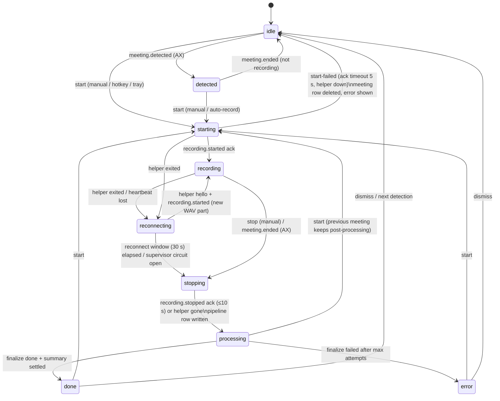

# Recording lifecycle

This is the contract for how a Note recording starts, runs, stops and gets post-processed. If the code and
this document disagree, the code is wrong.

- **Pure logic:** `packages/core/src/note/lifecycle.ts`. It holds the reducers, the retry policies and the
  transcript-delta reducer. Unit tests are in `lifecycle.test.ts`.
- **Runtime owner:** `apps/desktop/src/main/note-service.ts` (`NoteService`), in the Electron main process.
  It is the only code that drives the helper, feeds events to the machine and runs pipelines.
- **Durable store:** the worker's SQLite, migration 5. `lifecycle_state` holds the session snapshot and
  `pipeline_state` holds one row per meeting. The worker handlers are `lifecycle.*`, `pipeline.*` and
  `note.step*`.
- **Renderer:** reads everything from typed IPC. Requests are `note:session`, `note:pipeline` and
  `note:live-transcript`; events are `note:session`, `note:pipeline`, `note:transcript` and
  `note:changed`; the actions are `note:start`, `note:stop`, `note:dismiss` and `note:retry-step`. The
  renderer keeps no recording state of its own.
- **Integration tests:** `apps/desktop/src/main/note-service.test.ts` (real NoteService, Supervisor, mock
  helper and worker handlers), `apps/desktop/src/worker/lifecycle-steps.test.ts`, and
  `e2e/lifecycle.spec.ts` (Playwright).

Transcription is **live only**. Parakeet streaming runs in the helper (SpeechAnalyzer is the fallback). The
streamed finals are the transcript of record, and nothing re-transcribes after the meeting.

## Processes

| Process                                    | Owns                                                                                                                                                                         | Dies →                                                                                                   |
| ------------------------------------------ | ---------------------------------------------------------------------------------------------------------------------------------------------------------------------------- | -------------------------------------------------------------------------------------------------------- |
| `qrtz-helper` (Swift; TS mock on Linux/CI) | AX observation (detection, participants, active speaker), audio capture (Core Audio process tap → ScreenCaptureKit → mic), echo gate/AEC, Parakeet streaming ASR, WAV writer | Supervisor restarts it with backoff; NoteService goes to `reconnecting` (see F3)                         |
| main (`NoteService`)                       | the lifecycle machine, helper protocol, live transcript stream, post-processing pipelines, retry timers                                                                      | everything in-memory is lost; the persisted session + pipelines are recovered at next launch (see R1–R3) |
| worker (utilityProcess)                    | SQLite (meetings, segments, summaries, vectors, lifecycle), WAV repair/stitch, LLM calls, embeddings                                                                         | WorkerClient rejects pending calls; the failing step retries with backoff                                |
| renderer                                   | presentation only                                                                                                                                                            | reloads; re-fetches snapshots                                                                            |

## Session state machine

Owner: main. Persisted: every accepted transition (`lifecycle_state.session`), serialized so an older
snapshot can never overwrite a newer one. Broadcast: every transition goes out synchronously as
`note:session`. Only the level meter and ASR updates are throttled, to 50–150 ms.

| State        | Meaning                                                      | Capture live? | UI                                                              |
| ------------ | ------------------------------------------------------------ | ------------- | --------------------------------------------------------------- |
| idle         | nothing happening                                            | no            | Record button; `errorInfo` if the last start was refused        |
| detected     | AX sees a meeting (key, title, platform)                     | no            | "Record this meeting" prompt                                    |
| starting     | meeting row created, `recording.start` sent, waiting for ack | yes (opening) | spinner on Record                                               |
| recording    | helper capturing; live transcript streaming                  | yes           | live transcript, timer, level, pause, stop; `degraded[]` badges |
| reconnecting | helper died; supervisor restarting it                        | yes (gap)     | "Reconnecting… attempt n", stop still allowed                   |
| stopping     | waiting for the helper to flush the recogniser and WAV       | finishing     | "Stopping…"                                                     |
| processing   | per-meeting pipeline running                                 | no            | step list (finalize, summary, index) with live status           |
| done         | meeting usable (transcript final, summary saved)             | no            | meeting view; index may still be running                        |
| error        | finalize failed for good                                     | no            | error + "Retry" on the failed step                              |

`degraded[]` can be set while capturing. It is never cleared within one recording:

| Flag                | Source                                      | Effect                                                                          |
| ------------------- | ------------------------------------------- | ------------------------------------------------------------------------------- |
| `mic-only`          | screen-recording permission denied at start | only the local mic is captured                                                  |
| `ax-unavailable`    | accessibility permission denied at start    | no detection/participants/speaker names                                         |
| `asr-unavailable`   | helper `error{code: asr.unavailable}`       | audio only, no live transcript                                                  |
| `audio-unavailable` | helper `error{code: audio.unavailable}`     | nothing captured (the start is refused up front if both permissions are denied) |
| `transcript-gap`    | helper restarted mid-recording              | the restart interval is missing                                                 |

## Post-processing pipeline

There is one pipeline per meeting (`pipeline_state`, keyed by meeting id, cascade-deleted with the meeting).
It runs independently of the session, so a new recording can start while the previous meeting is still being
summarized. The pipeline is persisted **before** each step starts and after it ends, and broadcast as
`note:pipeline` every time.

| Step     | Worker call                 | Idempotent because                                                                                                                                                 | Policy                                                                                                  | On exhaustion                                                                                                         |
| -------- | --------------------------- | ------------------------------------------------------------------------------------------------------------------------------------------------------------------ | ------------------------------------------------------------------------------------------------------- | --------------------------------------------------------------------------------------------------------------------- |
| finalize | `note.stepFinalize`         | the stitch writes `main.stitch` then renames atomically and deletes parts after; WAV repair is a no-op on a good header; speaker fusion replaces the live segments | 3 attempts, 1 s → 2 s (×2, cap 16 s)                                                                    | meeting `failed`, session `error`, later steps stay `pending`, manual retry                                           |
| summary  | `note.stepSummary` (strict) | upsert of the one summary row                                                                                                                                      | 3 attempts, 2 s → 4 s → … cap 30 s; **non-retryable** (401/403/400, bad key) fails on the first attempt | on-device extractive summary saved with `llmError`, step `failed` with `fallback: true`, meeting `done`, manual retry |
| index    | `note.stepIndex`            | vectors keyed by segment rowid; `missingVectors` only picks unindexed lines                                                                                        | 3 attempts, 5 s → … cap 60 s                                                                            | step `failed` (chat falls back to full-text), manual retry; no embedder → `skipped`                                   |

Every delay has ±20% jitter (`retryDelay`), and `QRTZ_RETRY_SCALE` shrinks all of them for tests. Step
statuses are `pending → running → (done | skipped | retrying → running … | failed)`. A manual retry
(`note:retry-step`) gives the step a fresh attempt budget and re-arms every step after it. `note:resummarize`
(the existing "Retry" button and template changes) now routes through the same pipeline.

## Live transcript stream

- **Snapshot:** `note:live-transcript` returns `{meetingId, rev, segments[], partial}`.
- **Deltas:** each `note:transcript` event is `{meetingId, baseRev, rev, append[], partial}`, sent on every
  ASR partial or final.
- **Renderer:** applies a delta only when `rev === baseRev + 1` (`applyTranscriptDelta`). If a delta is
  missing or belongs to another meeting, it fetches a new snapshot. The partial is the volatile hypothesis:
  it is replaced in place on every update and removed when its utterance finalizes.
- **After a helper restart:** utterance ids become `p<part>-<id>` and timestamps are shifted by
  `partOffsetMs`, so segments from the two parts never collide and stay in meeting time.
- **Persistence:** each final is written to the DB right away (`note.appendLive`, an idempotent upsert),
  so the transcript survives any crash. After stop, and after a restart, the meeting view reads the
  persisted segments from `note:get`.

## Renderer

- **Hooks.** `packages/features/note/src/useRecording.ts` provides `useSession`, `usePipeline(id)` and
  `useLiveTranscript(id)`. Each fetches a snapshot, subscribes, and refetches on a gap.
- **Components.** The presentational pieces live in `@qrtz/ui` (`packages/ui/src/Lifecycle.tsx`):
  - `StreamingTranscript`: finals plus an italic volatile partial. It follows the newest line, scrolling up
    pauses that, and "Jump to live" resumes it.
  - `PipelineSteps`: per-step status with Retry.
  - `CaptureStatus`: reconnecting, degraded badges, and a refused-start error.
- **Meeting view.** While the meeting is live, it shows the streaming transcript front and center. Afterwards
  it opens on the Transcript tab, read from the DB, with the pipeline progress above it until every step is
  done. Starting a recording selects its meeting automatically.

## Failure modes

| #   | Failure                                                 | Detection                                                 | Fallback / retry                                                                                                                                                        | User-visible state                                                                  |
| --- | ------------------------------------------------------- | --------------------------------------------------------- | ----------------------------------------------------------------------------------------------------------------------------------------------------------------------- | ----------------------------------------------------------------------------------- |
| F1  | Both screen-recording and mic denied                    | permissions from helper `permissions.status`              | start refused before any row is created                                                                                                                                 | phase unchanged; `errorInfo.code = permission-denied` (retryable)                   |
| F2  | One permission denied                                   | same                                                      | record with what is available                                                                                                                                           | `degraded: mic-only` / `ax-unavailable`                                             |
| F3  | Helper crash / kill / heartbeat timeout while capturing | Supervisor `onStatus` (backoff) → `onHelperDown`          | Supervisor restarts it (500 ms × 2ⁿ, ±20%, cap 30 s; circuit opens after 5 restarts in 60 s). On `hello`, main sends `recording.start` to `<id>.p<n>.wav`. Window: 30 s | `reconnecting` (attempt, deadline) → `recording` + `transcript-gap`                 |
| F4  | Helper not back in 30 s or circuit open                 | timer / supervisor `failed`                               | stop with reason `helper-lost`; pipeline salvages persisted segments + repaired WAV parts                                                                               | `stopping` → `processing` → `done`, `stopReason: helper-lost`                       |
| F5  | `recording.start` not acked in 5 s                      | `waitFor` timeout                                         | send `recording.stop`, delete the empty meeting row                                                                                                                     | back to idle/detected with `errorInfo.code = start-timeout` (retryable)             |
| F6  | `recording.stop` not acked in 10 s                      | `waitFor` timeout                                         | finish from what is persisted, treat as crashed (duration from audio)                                                                                                   | normal processing                                                                   |
| F7  | Live segment write fails (worker busy/restarting)       | `note.appendLive` rejects                                 | 5 attempts, 250 ms ×2 (cap 4 s); then kept in memory and re-flushed at stop                                                                                             | none (transcript still shown live)                                                  |
| F8  | No ASR available                                        | helper `error asr.unavailable`                            | audio still recorded                                                                                                                                                    | `degraded: asr-unavailable`                                                         |
| F9  | No audio source                                         | helper `error audio.unavailable`                          | recording continues (AX, notes)                                                                                                                                         | `degraded: audio-unavailable`                                                       |
| F10 | Finalize fails (disk, corrupt WAV, worker down)         | step throws                                               | finalize policy                                                                                                                                                         | step `retrying` → `failed`; session `error`; Retry                                  |
| F11 | LLM 5xx/429/network                                     | `AppError.retryable`                                      | summary policy, then extractive fallback                                                                                                                                | step `retrying` → `failed (fallback)`; meeting `done` with on-device summary; Retry |
| F12 | LLM 401/403/400                                         | not retryable                                             | immediate extractive fallback                                                                                                                                           | same as F11, 1 attempt                                                              |
| F13 | Embedder unavailable / indexing fails                   | `stepIndex` returns `skipped` / throws                    | index policy                                                                                                                                                            | `skipped` / `failed`; chat uses FTS; Retry                                          |
| F14 | Meeting deleted mid-pipeline                            | `pipeline.save` returns ok:false; steps throw E_NOT_FOUND | pipeline row cascade-deleted                                                                                                                                            | meeting disappears                                                                  |
| F15 | Worker process crash                                    | WorkerClient rejects pending calls; worker restarted      | the step in flight retries                                                                                                                                              | step `retrying`                                                                     |

## Crash and restart recovery

At startup, after the worker is ready, `NoteService.recover()` runs. `start()` waits for it to finish.

- **R1, the app died while capturing.** If `lifecycle_state.session` was `starting`, `recording`,
  `reconnecting` or `stopping`, a pipeline is created for its meeting with stop reason `crash-recovered`. It
  uses the persisted `audioParts` and has `helperCrashed` set, so the duration comes from the repaired
  audio. Segments are already in the DB. The session restarts `idle`.
- **R2, the app died during post-processing.** Every `pipeline_state` row with `settled = 0` is resumed. A
  step that was `running` becomes `retrying` and runs again; every step is idempotent and attempts are kept.
  Steps already `done` are never repeated.
- **R3, legacy orphans.** Meetings stuck in `recording` or `processing` with no pipeline row (from crashes
  before the lifecycle existed) get a `crash-recovered` pipeline.
- **Retry timers are memory-only.** After a restart, a `retrying` step runs immediately instead of waiting out
  its backoff, which is what you want after a restart.

## Known limits

- Speaker activity (`active[]`) is kept in memory until stop. After an R1 crash, names come only from the
  live per-segment speaker stamped at append time.
- The WAV parts from a helper restart are stitched end to end. The gap is not padded with silence, so
  playback after the gap runs early by the length of the gap. The transcript timestamps are correct.
- The helper reports the capture source it fell back to (tap → SCK → mic) only as a log line. Exposing it
  as a structured event is backlog (see architecture-review.md).
