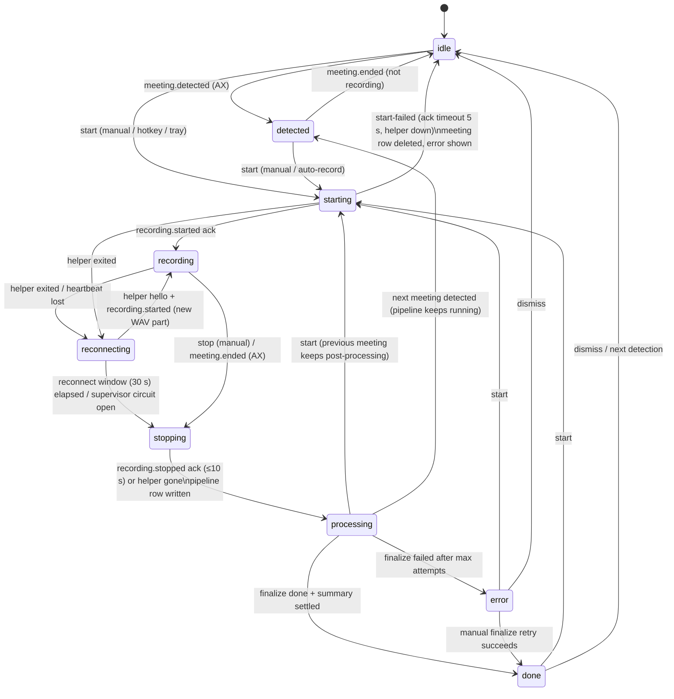

# Recording lifecycle

This is the contract for how a Note recording starts, runs, stops and gets post-processed. If the code and
this document disagree, the code is wrong.

- **Pure logic:** `packages/core/src/note/lifecycle.ts`. It holds the reducers, the retry policies and the
  transcript-delta reducer. Unit tests are in `lifecycle.test.ts`.
- **Runtime owner:** `apps/desktop/src/main/note-service.ts` (`NoteService`), in the Electron main process.
  It is the only code that drives the helper, feeds events to the machine and runs pipelines.
- **Durable store:** the worker's SQLite, migration 5. `lifecycle_state` holds the session snapshot and
  `pipeline_state` holds one row per meeting. The worker handlers are `lifecycle.*`, `pipeline.*` and
  `note.step*`.
- **Renderer:** reads everything from typed IPC. Requests are `note:session`, `note:pipeline` and
  `note:live-transcript`; events are `note:session`, `note:pipeline`, `note:transcript` and
  `note:changed`; the actions are `note:start`, `note:stop`, `note:dismiss` and `note:retry-step`. The
  renderer keeps no recording state of its own.
- **Integration tests:** `apps/desktop/src/main/note-service.test.ts` (real NoteService, Supervisor, mock
  helper and worker handlers), `apps/desktop/src/worker/lifecycle-steps.test.ts`, and
  `e2e/lifecycle.spec.ts` (Playwright).

Transcription is **cloud streaming with late backfill** (ADR 0044, reversing "live only"): the host streams
capture frames to the ASR provider (our Nemotron server, ElevenLabs second); while offline it spools the frames
(capped, retained) and transcribes them when the network returns, in meeting time. No on-device models.

## Processes

| Process                                    | Owns                                                                                                                                                                         | Dies →                                                                                                   |
| ------------------------------------------ | ---------------------------------------------------------------------------------------------------------------------------------------------------------------------------- | -------------------------------------------------------------------------------------------------------- |
| `qrtz-helper` (Swift; TS mock on Linux/CI) | AX observation (detection, participants, active speaker), audio capture (Core Audio process tap → ScreenCaptureKit → mic), echo gate/AEC, Parakeet streaming ASR, WAV writer | Supervisor restarts it with backoff; NoteService goes to `reconnecting` (see F3)                         |
| main (`NoteService`)                       | the lifecycle machine, helper protocol, live transcript stream, post-processing pipelines, retry timers                                                                      | everything in-memory is lost; the persisted session + pipelines are recovered at next launch (see R1–R3) |
| worker (utilityProcess)                    | SQLite (meetings, segments, summaries, vectors, lifecycle), WAV repair/stitch, LLM calls, embeddings                                                                         | WorkerClient rejects pending calls; the failing step retries with backoff                                |
| renderer                                   | presentation only                                                                                                                                                            | reloads; re-fetches snapshots                                                                            |

## Session state machine

Owner: main. Persisted: every accepted transition (`lifecycle_state.session`), serialized so an older
snapshot can never overwrite a newer one. Broadcast: every transition goes out synchronously as
`note:session`. Only the level meter and ASR updates are throttled, to 50–150 ms.

| State        | Meaning                                                      | Capture live? | UI                                                              |
| ------------ | ------------------------------------------------------------ | ------------- | --------------------------------------------------------------- |
| idle         | nothing happening                                            | no            | Record button; `errorInfo` if the last start was refused        |
| detected     | AX sees a meeting (key, title, platform)                     | no            | "Record this meeting" prompt                                    |
| starting     | meeting row created, `recording.start` sent, waiting for ack | yes (opening) | spinner on Record                                               |
| recording    | helper capturing; live transcript streaming                  | yes           | live transcript, timer, level, pause, stop; `degraded[]` badges |
| reconnecting | helper died; supervisor restarting it                        | yes (gap)     | "Reconnecting… attempt n", stop still allowed                   |
| stopping     | waiting for the helper to flush the recogniser and WAV       | finishing     | "Stopping…"                                                     |
| processing   | per-meeting pipeline running                                 | no            | step list (finalize, summary, index) with live status           |
| done         | meeting usable (transcript final, summary saved)             | no            | meeting view; index may still be running                        |
| error        | finalize failed for good                                     | no            | error + "Retry" on the failed step                              |

`degraded[]` can be set while capturing. It is never cleared within one recording, except for device failures (below)
and the helper's own start reports (`asr-unavailable`, `audio-unavailable`; N42, ADR 0034), which end at `helper-lost`:

| Flag                | Source                                                                             | Effect                                                                          |
| ------------------- | ---------------------------------------------------------------------------------- | ------------------------------------------------------------------------------- |
| `mic-only`          | screen-recording denied at start, or revoked mid-recording (`permission.revoked`)  | only the local mic is captured                                                  |
| `no-mic`            | microphone revoked mid-recording (`permission.revoked`)                            | only system audio (the other side of the call) is captured                      |
| `ax-unavailable`    | accessibility denied at start or revoked mid-recording                             | no detection/participants/speaker names                                         |
| `asr-unavailable`   | helper `error{code: asr.unavailable}` (each part's start; ends at `helper-lost`)   | audio only, no live transcript                                                  |
| `audio-unavailable` | helper `error{code: audio.unavailable}` (each part's start; ends at `helper-lost`) | nothing captured (the start is refused up front if both permissions are denied) |
| `transcript-gap`    | helper restarted mid-recording                                                     | the restart interval is missing                                                 |

**Silent input (N29, ADR 0025)** is separate from `degraded[]` because it clears. After `capture.silent{source}`
(60 s under ≈ −70 dBFS), `silent[]` holds `{source, sinceMs}` until `capture.audible{source}`. `SessionView` has
`silent` and `noAudio: true` when neither source delivers audio, counting silent, lost and denied sources. Each
stretch becomes a `silentSpans` entry in meeting ms. A revoke of that source, `helper-lost` (the new helper
measures again) and stop all close it. Duplicates, an audible without a silent, and silence of a lost source are
ignored. At stop (and R1 recovery) spans and **capture fallbacks** (H8, `capture.fallback{from, to, reason}`,
`to: null` = `audio-unavailable` now) go to `PipelineState.capture`, which `note:pipeline` carries. The summary
prompt lists stretches of 60 s or more as capture gaps and tells the model not to fill them.

**Device failure (N35, ADR 0028).** `capture.degraded{degraded, reason}` comes from a source whose in-source mic
failed. It is applied like a revoke, but only while `recording`, and only for the flags not already set. Those flags
are listed in `deviceLost` (on `SessionView` too). They are the one exception to "never cleared within one
recording": `helper-restored` removes them, unless a revoke of the same flag took them over in between. Each failure
goes to `deviceFailures` and then `PipelineState.capture.deviceFailures`, apart from revokes.

**Lost sources (N39, N40, ADR 0031).** `lostSpans [{source, startMs, endMs?}]` (meeting ms, ≤ 16, omitted when
empty) records when the helper did not deliver a source at all. A stretch opens when a flag takes a source away
(`degraded` with a time, `capture-degraded`, `capture-fallback{to: null}`) and that source has none open. It ends at
`helper-restored` for a source the new `degraded[]` gives back (a device failure), or at `stop-requested`. A crash
leaves it open. It goes to `PipelineState.capture.lostSpans`, and the summary counts it as that source's silence, so
a lost mic plus quiet system audio is "no audio at all". A start with the mic denied flags `no-mic` right after
`start-acked`, next to `mic-only` for a denied screen, so that mic is lost from 0.

**Lines behind an ack (N37, ADR 0029).** `start-acked` / `helper-restored` are applied in the start's continuation,
after the line that resolved its waiter. Lines from the same chunk that the new recording owns (`capture.degraded`,
`asr`, and since N43 `ax.activeSpeaker`) are held behind the ack and replayed right after the transition, or dropped
if the start does not take. A speaker event outside `recording` / `stopping` is ignored (ADR 0035): before the ack
the helper's clock is not the part's.

**Helper start reports (N42, ADR 0034).** The helper sends `error{asr.unavailable}`, `capture.fallback{to: null}` and
`error{audio.unavailable}` at every part's start, before `recording.started`. So `asr-unavailable` and
`audio-unavailable` belong to the helper that sent them: `helper-lost` (also while reconnecting) removes them and
ends the lost stretches they held open. The next helper's reports arrive while `reconnecting` and apply to its part.

**Part offsets (H7, ADR 0032).** `partOffsetsMs` (parallel to `audioParts`, written by the first `helper-restored`,
omitted for one part) goes to `PipelineContext.partOffsetsMs` at the stop and at R1 recovery.

## Post-processing pipeline

There is one pipeline per meeting (`pipeline_state`, keyed by meeting id, cascade-deleted with the meeting).
It runs independently of the session, so a new recording can start while the previous meeting is still being
summarized. The pipeline is persisted **before** each step starts and after it ends, and broadcast as
`note:pipeline` every time.

| Step     | Worker call                 | Idempotent because                                                                                                                                                                                                                                                                         | Policy                                                                                                  | On exhaustion                                                                                                         |
| -------- | --------------------------- | ------------------------------------------------------------------------------------------------------------------------------------------------------------------------------------------------------------------------------------------------------------------------------------------ | ------------------------------------------------------------------------------------------------------- | --------------------------------------------------------------------------------------------------------------------- |
| finalize | `note.stepFinalize`         | the stitch writes `main.stitch` (pads each reconnect gap, H7), renames it to `main.stitched` (commit), deletes the parts, then renames over `main`; a re-run that finds `.stitched` only finishes (N41); WAV repair is a no-op on a good header; speaker fusion replaces the live segments | 3 attempts, 1 s → 2 s (×2, cap 16 s)                                                                    | meeting `failed`, session `error`, later steps stay `pending`, manual retry                                           |
| summary  | `note.stepSummary` (strict) | upsert of the one summary row                                                                                                                                                                                                                                                              | 3 attempts, 2 s → 4 s → … cap 30 s; **non-retryable** (401/403/400, bad key) fails on the first attempt | on-device extractive summary saved with `llmError`, step `failed` with `fallback: true`, meeting `done`, manual retry |
| index    | `note.stepIndex`            | vectors keyed by segment rowid; `missingVectors` only picks unindexed lines                                                                                                                                                                                                                | 3 attempts, 5 s → … cap 60 s                                                                            | step `failed` (chat falls back to full-text), manual retry; no embedder → `skipped`                                   |

Every delay has ±20% jitter (`retryDelay`), and `QRTZ_RETRY_SCALE` shrinks all of them for tests. Step
statuses are `pending → running → (done | skipped | retrying → running … | failed)`. A manual retry
(`note:retry-step`) gives the step a fresh attempt budget and re-arms every later step that isn't `done` (a finalize retry
re-arms all of them). A result that comes back for a step re-armed while it was in flight is dropped.

Two more rules, from the cross-model review (`architecture-review.md`):

- **Durability barrier.** A step runs only after its `running` state is saved. If that save fails, the attempt
  counts as a retryable failure and the step is not executed.
- **One heavy step at a time.** Summary and index run through a single queue across all meetings, so a
  recovered backlog or retry timers that line up never send concurrent LLM calls. Finalize is local and runs
  immediately. `note:resummarize`
  (the existing "Retry" button) routes through the same pipeline. A template change re-runs the summary
  directly with its own spinner and error; routing it through the pipeline is backlog.

## Live transcript stream

- **Snapshot:** `note:live-transcript` returns `{meetingId, rev, segments[], partial}`.
- **Deltas:** each `note:transcript` event is `{meetingId, baseRev, rev, append[], partial}`, sent on every
  ASR partial or final.
- **Renderer:** applies a delta only when `rev === baseRev + 1` (`applyTranscriptDelta`). If a delta is
  missing or belongs to another meeting, it fetches a new snapshot. The partial is the volatile hypothesis:
  it is replaced in place on every update and removed when its utterance finalizes.
- **After a helper restart:** utterance ids become `p<part>-<id>` and timestamps are shifted by
  `partOffsetMs`, so segments from the two parts never collide and stay in meeting time.
- **Persistence:** each final is written to the DB right away (`note.appendLive`, an idempotent upsert),
  so the transcript survives any crash. After stop, and after a restart, the meeting view reads the
  persisted segments from `note:get`.

## Renderer

- **Hooks.** `packages/features/note/src/useRecording.ts` provides `useSession`, `usePipeline(id)` and
  `useLiveTranscript(id)`. Each fetches a snapshot, subscribes, and refetches on a gap.
- **Components.** The presentational pieces live in `@qrtz/ui` (`packages/ui/src/Lifecycle.tsx`):
  - `StreamingTranscript`: finals plus an italic volatile partial. It follows the newest line, scrolling up
    pauses that, and "Jump to live" resumes it.
  - `PipelineSteps`: per-step status with Retry.
  - `CaptureStatus`: reconnecting, degraded badges, and a refused-start error.
- **Meeting view.** While the meeting is live, it shows the streaming transcript front and center. Afterwards
  it opens on the Transcript tab, read from the DB, with the pipeline progress above it until every step is
  done. Starting a recording selects its meeting automatically.

## Failure modes

| #   | Failure                                                 | Detection                                                  | Fallback / retry                                                                                                                                                                                                               | User-visible state                                                                                  |
| --- | ------------------------------------------------------- | ---------------------------------------------------------- | ------------------------------------------------------------------------------------------------------------------------------------------------------------------------------------------------------------------------------ | --------------------------------------------------------------------------------------------------- |
| F1  | Both screen-recording and mic denied                    | permissions from helper `permissions.status`               | start refused before any row is created                                                                                                                                                                                        | phase unchanged; `errorInfo.code = permission-denied` (retryable)                                   |
| F2  | One permission denied                                   | same                                                       | record with what is available                                                                                                                                                                                                  | `degraded: mic-only` / `ax-unavailable`                                                             |
| F3  | Helper crash / kill / heartbeat timeout while capturing | Supervisor `onStatus` (backoff) → `onHelperDown`           | Supervisor restarts it (500 ms × 2ⁿ, ±20%, cap 30 s; circuit opens after 5 restarts in 60 s). On `hello`, main sends `recording.start` to `<id>.p<n>.wav`. Window: 30 s                                                        | `reconnecting` (attempt, deadline) → `recording` + `transcript-gap`                                 |
| F4  | Helper not back in 30 s or circuit open                 | timer / supervisor `failed`                                | stop with reason `helper-lost`; pipeline salvages persisted segments + repaired WAV parts                                                                                                                                      | `stopping` → `processing` → `done`, `stopReason: helper-lost`                                       |
| F5  | `recording.start` not acked in 5 s                      | `waitFor` timeout                                          | send `recording.stop`, delete the empty meeting row                                                                                                                                                                            | back to idle/detected with `errorInfo.code = start-timeout` (retryable)                             |
| F6  | `recording.stop` not acked in 10 s                      | `waitFor` timeout                                          | send scoped `recording.abort{audioPath}` (2 s deadline; a dictation survives); restart the helper only if that also times out; finish from what is persisted, treat as crashed (duration from audio)                           | normal processing                                                                                   |
| F7  | Live segment write fails (worker busy/restarting)       | `note.appendLive` rejects                                  | 5 attempts, 250 ms ×2 (cap 4 s); then kept in memory and re-flushed at stop                                                                                                                                                    | none (transcript still shown live)                                                                  |
| F8  | No ASR available                                        | helper `error asr.unavailable`                             | audio still recorded                                                                                                                                                                                                           | `degraded: asr-unavailable`                                                                         |
| F9  | No audio source                                         | helper `error audio.unavailable`                           | recording continues (AX, notes)                                                                                                                                                                                                | `degraded: audio-unavailable`                                                                       |
| F10 | Finalize fails (disk, corrupt WAV, worker down)         | step throws                                                | finalize policy                                                                                                                                                                                                                | step `retrying` → `failed`; session `error`; Retry                                                  |
| F11 | LLM 5xx/429/network                                     | `AppError.retryable`                                       | summary policy, then extractive fallback                                                                                                                                                                                       | step `retrying` → `failed (fallback)`; meeting `done` with on-device summary; Retry                 |
| F12 | LLM 401/403/400                                         | not retryable                                              | immediate extractive fallback                                                                                                                                                                                                  | same as F11, 1 attempt                                                                              |
| F13 | Embedder unavailable / indexing fails                   | `stepIndex` returns `skipped` / throws                     | index policy                                                                                                                                                                                                                   | `skipped` / `failed`; chat uses FTS; Retry                                                          |
| F14 | Meeting deleted mid-pipeline                            | `pipeline.save` returns ok:false; steps throw E_NOT_FOUND  | pipeline row cascade-deleted                                                                                                                                                                                                   | meeting disappears                                                                                  |
| F15 | Worker process crash                                    | WorkerClient rejects pending calls; worker restarted       | the step in flight retries                                                                                                                                                                                                     | step `retrying`                                                                                     |
| F16 | TCC permission revoked mid-recording                    | helper `permission.revoked` (TCC polled while capturing)   | keep recording with what is left; a running dictation is ended by the helper (`dictation.stopped{reason}`) and stopped gracefully by talk                                                                                      | `degraded: no-mic` / `mic-only` / `audio-unavailable` / `ax-unavailable` (see `helper-protocol.md`) |
| F17 | Dictation started during a recording                    | arbiter (mux)                                              | both run; one shared mic tap; duplicate starts ignored                                                                                                                                                                         | no change to the recording                                                                          |
| F18 | The helper can't create the recording's WAV             | `error{recording.file, audioPath}` for the start in flight | the helper already tore the recording down (fail closed, `helper-protocol.md`); fail the start at once, delete the empty meeting row; a `recording.busy` naming no active file restarts the helper (watchdog, logged as a bug) | back to idle/detected with `errorInfo.code = recording-file` (retryable)                            |

## Crash and restart recovery

At startup, after the worker is ready, `NoteService.recover()` runs. `start()` waits for it to finish.

- **R1, the app died while capturing.** If `lifecycle_state.session` was `starting`, `recording`,
  `reconnecting` or `stopping`, a pipeline is created for its meeting with stop reason `crash-recovered`. It
  uses the persisted `audioParts` and has `helperCrashed` set, so the duration comes from the repaired
  audio. Segments are already in the DB. The session restarts `idle`.
- **R2, the app died during post-processing.** Every `pipeline_state` row with `settled = 0` is resumed. A
  step that was `running` becomes `retrying` and runs again; every step is idempotent and attempts are kept.
  Steps already `done` are never repeated.
- **R3, legacy orphans.** Meetings stuck in `recording` or `processing` with no pipeline row (from crashes
  before the lifecycle existed) get a `crash-recovered` pipeline.
- **Retry timers are memory-only.** After a restart, a `retrying` step runs immediately instead of waiting out
  its backoff, which is what you want after a restart.

## Known limits

- A live final whose append exhausts its retries (worker down for about 8 s) is kept in memory and flushed
  with the same retry policy at stop. If main also crashes before stop, that line is lost. A durable spill
  queue is backlog (architecture-review C7).
- Helper acks are correlated by audio path. A `recording.started` for a path main isn't expecting gets an
  immediate `recording.stop`, and a stop ack that times out restarts the helper so finalize never repairs a
  WAV that is still being written.
- ASR finals that arrive in `stopping` (the recogniser flush) are kept.

- Speaker activity (`active[]`) is kept in memory until stop. After an R1 crash, names come only from the
  live per-segment speaker stamped at append time.
- The WAV parts from a helper restart are stitched with each reconnect gap as zero PCM (H7, ADR 0032), so audio
  time matches transcript time. One gap's pad is capped at 35 s (reconnect window + start ack). Part offsets are
  stamped from a monotonic clock in the runtime (N45, ADR 0037), so a wall jump or sleep during a reconnect does not
  slide the next part's transcript away from the pad. A session row from an older build has no offsets and stitches
  end to end.
